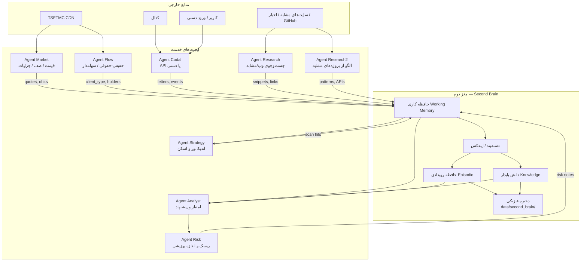
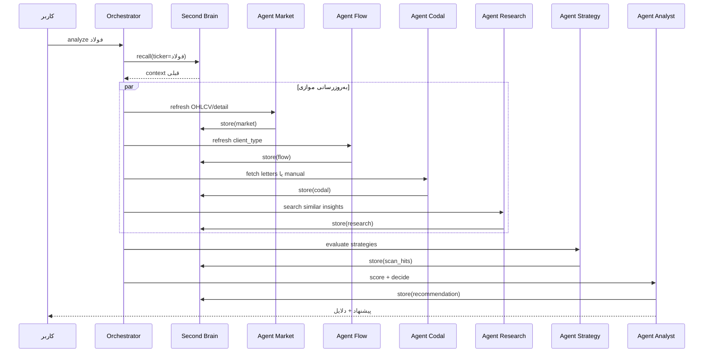

# معماری چندایجنتی ARYA + مغز دوم (Second Brain)

هدف: جداسازی خدمات به‌صورت **ایجنت‌های مستقل**، با یک **حافظه مرکزی** که دانش را نگه می‌دارد، دسته‌بندی می‌کند و در اختیار بقیه قرار می‌دهد. در صورت نیاز، داده روی دیسک (درایو) پایدار می‌شود.

---

## ۱) دیاگرام کلی



---

## ۲) دیاگرام توالی یک چرخه تحلیل



---

## ۳) نقش ایجنت‌ها

| ایجنت | مسئولیت | ورودی | خروجی به مغز دوم |
|--------|---------|--------|-------------------|
| **Market** | قیمت، OHLCV، جزئیات نماد، صف | TSETMC | `market/*` |
| **Flow** | حقیقی/حقوقی، سهامداران | TSETMC | `flow/*` |
| **Codal** | اطلاعیه API یا دستی | کدال / کاربر | `codal/*` |
| **Strategy** | قوانین اندیکاتور + اسکن | OHLCV از حافظه | `strategy/*` |
| **Research** | جست‌وجوی سایت‌های مرتبط، نکات مفید | وب | `research/web/*` |
| **Research2** | الگو از پروژه‌های مشابه (GitHub و …) | وب/GitHub | `research/peers/*` |
| **Analyst** | ترکیب بخش‌ها، امتیاز، پیشنهاد | حافظه | `analysis/*` |
| **Risk** | حد ضرر، اندازه پوزیشن | تحلیل | `risk/*` |
| **Orchestrator** | زمان‌بندی و ترتیب فراخوانی | کاربر | — |

---

## ۴) مغز دوم (Second Brain)

### لایه‌ها

1. **Working Memory** — دادهٔ جلسه جاری (در RAM + فایل موقت)
2. **Episodic** — رویدادهای زمانی (تحلیل دیروز فولاد، اسکن استراتژی X)
3. **Knowledge** — دانش پایدار دسته‌بندی‌شده (نگاشت نماد، قوانین، الگوهای Peer)
4. **Disk** — `data/second_brain/` برای بقا بعد از بستن برنامه

### ساختار دیسک پیشنهادی

```text
data/second_brain/
  working/           # وضعیت آخرین جلسه
  episodic/          # YYYY-MM-DD/*.json
  knowledge/
    symbols/         # per-ticker summaries
    strategies/      # نتایج اسکن ذخیره‌شده
    research/        # یافته‌های وب دسته‌بندی‌شده
    peers/           # الگوهای پروژه‌های مشابه
  index.json         # ایندکس سبک برای جست‌وجو
```

### قرارداد پیام به حافظه

```json
{
  "agent": "market",
  "kind": "instrument_detail",
  "ticker": "فولاد",
  "ts": "2026-10-06T19:00:00Z",
  "tags": ["tsetmc", "eps", "pe"],
  "payload": { },
  "ttl_hours": 24
}
```

مغز دوم:
- ذخیره می‌کند
- بر اساس `kind` و `tags` دسته‌بندی می‌کند
- به Analyst / Strategy فقط **خلاصهٔ مرتبط** می‌دهد (نه کل وب)

---

## ۵) ایجنت‌های جست‌وجو (Research)

وظیفه: پیدا کردن اطلاعات **مفید و مرتبط با بورس ایران**، نه کپی بی‌هدف.

منابع نمونه:
- مستندات endpointهای TSETMC / کدال
- پروژه‌های GitHub مشابه (pytse-client، 5j9/tsetmc، …)
- اخبار/تحلیل عمومی (با برچسب منبع و تاریخ)

خروجی اجباری:
- `summary` کوتاه فارسی
- `source_url`
- `relevance` (0–1)
- `tags`
- ارسال به Second Brain با `kind=research_note`

Analyst **مستقیم** به وب نمی‌رود؛ فقط از حافظه می‌خواند.

---

## ۶) قوانین طراحی

1. هیچ ایجنتی state بلندمدت خودش را پنهان نگه ندارد → همه چیز از طریق مغز دوم.
2. نوشتن روی دیسک برای دادهٔ > جلسه یا قابل ممیزی (کدال دستی، توصیه، پژوهش).
3. به‌روزرسانی: Orchestrator می‌تواند زمان‌بندی کند (مثلاً هر روز Market+Flow).
4. P0 Symbol Master و Binaryها همچنان تحت کنترل کیفیت قبلی‌اند.
5. محدوده بازار: فقط بورس ایران.

---

## ۷) نقشه پیاده‌سازی کد

| مسیر | نقش |
|------|-----|
| `src/arya/agents/base.py` | قرارداد ایجنت |
| `src/arya/agents/second_brain.py` | حافظه + دیسک |
| `src/arya/agents/orchestrator.py` | هماهنگی |
| `src/arya/agents/research_agent.py` | جست‌وجو و ارسال به حافظه |
| `data/second_brain/` | مخزن فیزیکی |

CLI پیشنهادی بعدی:
```text
arya brain status
arya brain recall --ticker فولاد
arya research run --query "افزایش سرمایه فولاد"
```
