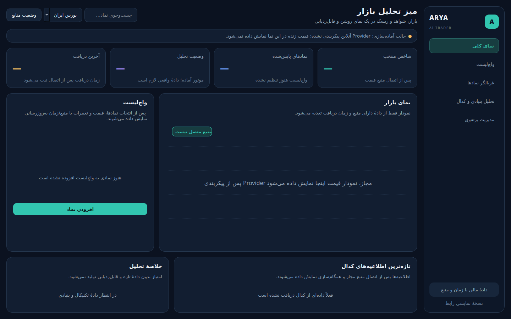

# راهنمای اولیهٔ داشبورد گرافیکی

## اجرا

رابط دسکتاپ PySide6 اختیاری است:

```bash
pip install -e '.[gui]'
arya gui
```

داشبورد از ابتدا راست‌به‌چپ طراحی شده و پوستهٔ تیرهٔ سرمه‌ای با تأکید فیروزه‌ای و نشانه‌های سبز/قرمز برای وضعیت بازار دارد. در عرض‌های معمول دسکتاپ، ناوبری در سمت راست، خلاصه‌ها در بالا و محتوای تحلیلی در بخش مرکزی قرار می‌گیرند.



## وضعیت فعلی

این commit یک **پوستهٔ رابط/پیش‌نمایش قابل اجرا** اضافه می‌کند، نه اتصال دادهٔ زنده. وقتی provider واقعی پیکربندی نشده باشد:

- قیمت‌ها و شاخص‌ها به‌صورت «—» نمایش داده می‌شوند.
- نمودار پیام «منبع متصل نیست» دارد؛ منحنی قیمت ساختگی برای شبیه‌سازی بازار نمایش داده نمی‌شود.
- واچ‌لیست و اطلاعیه‌های کدال پیام حالت خالی نشان می‌دهند.
- آیتم‌های ناوبریِ هنوز پیاده‌سازی‌نشده غیرفعال‌اند.

هدف این است که اعداد Mock تصادفی هرگز به‌اشتباه به‌عنوان دادهٔ جاری یا توصیهٔ معامله دیده نشوند. پس از اضافه‌شدن APIهای مجاز، `Recommendation`، وضعیت منبع و زمان تازگی به این اجزا متصل می‌شوند.

## زبان بصری

- پس‌زمینهٔ سرمه‌ای عمیق برای کاهش خستگی در استفادهٔ طولانی.
- پنل‌های روشن‌تر و border کم‌کنتراست برای تفکیک سلسله‌مراتب، نه تزئین پرزرق‌وبرق.
- فیروزه‌ای برای عملیات/انتخاب اصلی، آبی و بنفش برای داده‌های اطلاعاتی، سبز برای مثبت و قرمز برای منفی؛ رنگ به‌تنهایی جایگزین متن وضعیت نیست.
- فونت فارسی Vazirmatn با fallback به Segoe UI و Tahoma.
